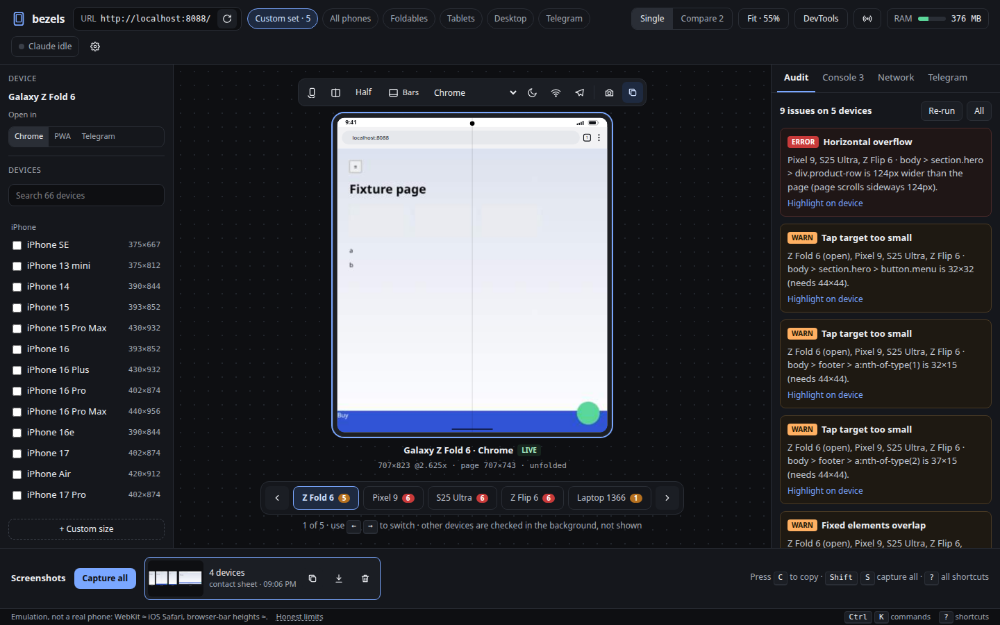
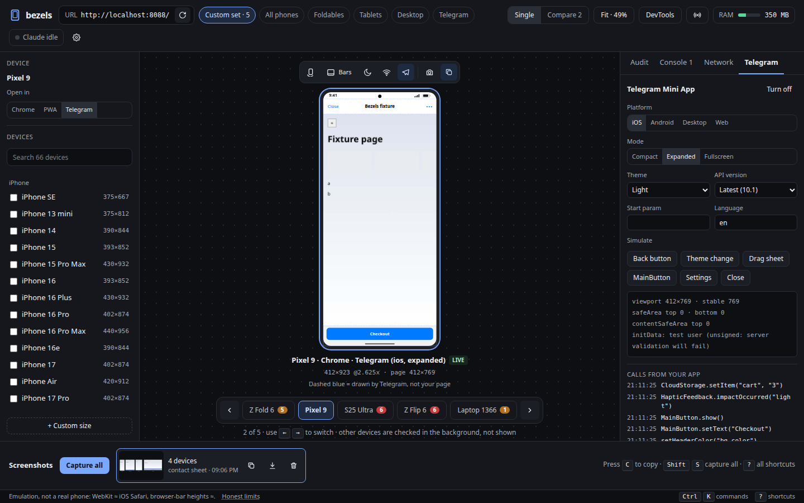
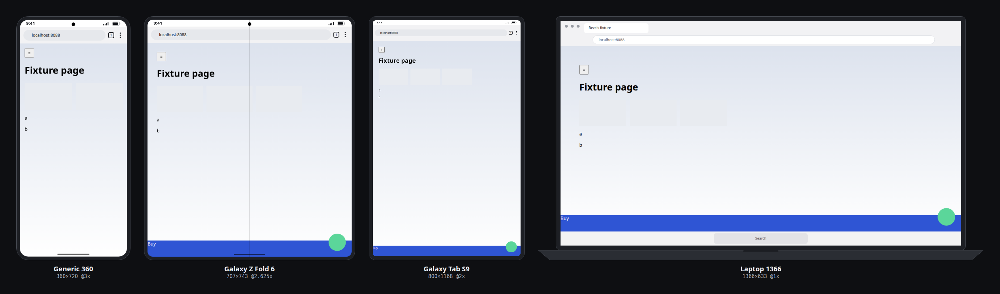

# Bezels

[](https://github.com/n1th1n-19/bezels/actions/workflows/ci.yml) [](LICENSE)

Shows a web page the way it looks on a real phone, foldable, tablet, laptop or desktop **inside that device's browser**. It runs real browser engines with device emulation (Chromium for Android and desktop, WebKit for iPhone and iPad) and draws the device frame around them. Claude Code can drive it as an agent browser over MCP.



One engine with three ways in:

```
            ┌────────────── core (Node + TypeScript, one process) ──────────────┐
            │ Playwright: one Chromium + one WebKit process, a context per page  │
            │ deduped pages · live limit · freeze/evict · memory budget          │
            └──────────┬────────────────────────┬───────────────────────┬────────┘
              MCP server (stdio)        Web UI (static, served         CLI
              → Claude Code             by core on :4477, WebSocket)   bezels shot/audit
```

The UI and Claude Code see the same sessions. Every action goes through one method table ([src/core/rpc.ts](src/core/rpc.ts)), so anything an MCP tool can do, the UI can do too.

## Install

One line (Linux, macOS; Windows via WSL2). Needs git and Node.js 20+:

```bash
curl -fsSL https://raw.githubusercontent.com/n1th1n-19/bezels/main/install.sh | bash
```

Before touching anything it shows what's already there and what it will install, then asks to continue:

| What | Size | Notes |
|---|---|---|
| Bezels source → `~/.bezels` | ~2 MB | re-running the installer updates it |
| npm packages | ~150 MB | Playwright, MCP SDK, React, Vite |
| Chromium | ~180 MB | Android + desktop devices, shared Playwright cache |
| WebKit | ~100 MB | iPhone + iPad devices (`--no-webkit` to skip) |
| WebKit system libraries | small | Linux only, apt + sudo, **only the packages actually missing** (shown before installing) |
| `~/.local/bin/bezels` | tiny | launcher |
| Claude Code MCP server | — | asks first: `claude mcp add bezels -s user …` |
| `wl-clipboard` / `xclip` | small | optional, asks, only for `bezels shot --copy` |

Prefer to read it first? `curl -fsSL https://raw.githubusercontent.com/n1th1n-19/bezels/main/install.sh -o install.sh && less install.sh && bash install.sh`

Each step shows progress (download %, elapsed time). If one fails, it prints the last lines of its log. Options go after `bash -s --`: `--yes`, `--dir PATH`, `--no-webkit`, `--no-mcp`. From a clone, `./install.sh` installs in place.

## Setup by hand

Requires Node 20+. From source:

```bash
git clone https://github.com/n1th1n-19/bezels && cd bezels
npm ci
npx playwright install --with-deps chromium webkit   # --with-deps adds WebKit's system libraries on Linux (sudo)
npm run build
```

Once it's published to npm: `npx bezels serve`.

Optional: `sudo apt install wl-clipboard` (Wayland) or `xclip` (X11) for `bezels shot --copy`. The UI copies through the browser and needs neither.

## Use

```bash
node dist/cli.js serve                       # UI at http://localhost:4477
node dist/cli.js serve --watch ../myapp/src  # also reload every device when files change
```

**Claude Code:**

```bash
claude mcp add bezels -- node /abs/path/to/bezels/dist/mcp.js
```

If the UI daemon is already running, the MCP server proxies to it, so you watch Claude work. If it isn't, the MCP process runs the engine itself and serves the UI on the same port.

The intended loop: *open localhost:3000 on `phones,folds` → `audit_all` → fix the CSS → `audit_layout` → `screenshot_matrix`.*

**CLI** (handy for CI). It uses a running daemon when there is one, otherwise runs in-process:

```bash
node dist/cli.js shot http://localhost:3000 --devices phones,folds --framed --out ./shots
node dist/cli.js shot http://localhost:3000 --device iphone-16-pro --framed --copy
node dist/cli.js audit http://localhost:3000 --devices all --json   # exits 1 if any error-level issue is found
node dist/cli.js devices
```

Device sets: `phones iphones android folds tablets laptops desktop breakpoints telegram all`, or any device id.

## How the spec gaps were resolved

| Problem | Decision |
|---|---|
| WebKit has no screencast | Chromium streams through the ack-based CDP `Page.startScreencast`, capped at 15 fps. WebKit is polled with JPEG screenshots: about 6 fps right after input, 1 fps when idle. A frame is skipped while one is still in flight and dropped if unchanged, so nothing queues. The UI labels it "live view polled". |
| WebKit has no CDP | Each feature uses Playwright's cross-engine API where one exists (geolocation, timezone, locale, permissions, offline, colour scheme, reduced motion). Everything else is marked **Chromium only** in the UI rather than hidden. On WebKit, safe areas are approximated by rewriting `env(safe-area-inset-*)` rules, and timezone/locale changes rebuild the context. |
| Dedupe rarely triggers | Android uses Chrome's real *reduced* UA (`Android 10; K`), so same-size phones such as Pixel 7/8 or Flip 5/6 really do share one page, as Chrome on those phones would. |
| Name was half-migrated | It's `bezels` everywhere: package, CLI, MCP server and `~/.config/bezels/`. |
| Next.js for a static export | The UI is Vite + React + Tailwind, built to `ui/dist` and served by core's own HTTP server. That gives the same outcome as `output: 'export'` (no second dev server) with a lighter toolchain. The components only use plain React, so moving to Next later is a mechanical change. |
| Mockups reference a missing `support.js` | The mockups were used only as visual reference and rebuilt as components. |

## Memory (spec 2b)

- One browser per engine. WebKit launches only when an Apple device opens, and an engine shuts down after 3 min with no contexts.
- Only the focused device (plus the Compare partner) is live. Others are frozen with `Page.setWebLifecycleState`, then closed when idle or when over `maxMemoryMB`, using LRU order. A closed page reopens at the same URL and scroll position.
- `screenshot_matrix` and `audit_all` run one device at a time, with one context per config group, resizing between devices.
- Captures are streamed to disk. The tray loads 120 px thumbnails, and MCP replies carry a preview of at most 768 px plus the full-res path.
- DevTools data is collected only for the focused device, in capped ring buffers (1,000 console lines, 500 requests). Response bodies are fetched on demand.
- The meter uses PSS from `/proc`, so Chromium's shared pages aren't double-counted. Open it with **Shift+M**; MCP `stats()` returns the same numbers.

`npm run bench` covers idle, 1 live device and a 10-device matrix. It fails if a scenario exceeds the spec target or regresses more than 15% against [bench/baseline.json](bench/baseline.json). On this machine:

| Scenario | Peak | Target |
|---|---|---|
| Idle | 88 MB | 150 MB |
| 1 live device | 240 MB | 500 MB |
| 10-device matrix | 388 MB | 1000 MB |

## Telegram Mini App mode



Turn it on with **Shift+T**, or "Open in → Telegram". A mock `Telegram.WebApp` (Bot API 10.1) is injected before page scripts, and the real `telegram-web-app.js` request is intercepted. The mock covers:

- the full `--tg-*` CSS variables
- viewport and stable height
- safe area and content safe area per device and mode
- MainButton, SecondaryButton, BackButton and SettingsButton, drawn by Bezels and clickable
- popups and QR
- CloudStorage, DeviceStorage and SecureStorage, kept in memory
- per-version method gating

initData is **unsigned** by default, so server-side validation fails on purpose. Put `BEZELS_TG_BOT_TOKEN=<test bot token>` in `.env` to sign it exactly like Telegram does. The audit adds checks for vh misuse, content under Telegram UI, unsupported methods, vertical swipes left on, and a missing `ready()`.

## Screenshots

Per device: screen or full page, framed or plain, transparent or solid, 1× or device DPR. **C** copies to the clipboard, **S** saves, **Shift+S** copies a contact sheet of the whole set. Files land in `./shots/` (`2026-11-06_iphone-16-pro_portrait.png`), and Claude Code's captures appear in the same tray.



## Keyboard

Every action has a key or is in the command palette (**Ctrl/Cmd+K**). **?** shows the cheat sheet. Keys are remappable in Settings (**Ctrl/Cmd+,**) and stored in `~/.config/bezels/keymap.json`, with conflicts flagged. Clicking a device (or pressing **Enter**) sends keystrokes to the page; **Esc** takes them back. `g`-chords (`g e`, `g n`, …) time out after 1 s.

## Security

The server binds to `127.0.0.1` only. RPC and WebSocket requests are rejected unless the Origin is Bezels itself (or comes from no browser at all, as with the CLI and MCP), and a wrong Host header is rejected too, which blocks DNS rebinding. Colours that the page under test passes to `setHeaderColor` and similar calls are validated before they reach the frame SVG.

## Layout

| Path | What |
|---|---|
| [src/shared/devices.ts](src/shared/devices.ts) | 66 devices with a source per entry (`npm run devices:json` → `devices.json`) |
| [src/shared/layout.ts](src/shared/layout.ts) | the realism rule: viewport = screen − status bar − browser bars, per orientation / bars / fold / Telegram |
| [src/shared/frame.ts](src/shared/frame.ts) | SVG device frames, shared by the UI and the screenshot compositor |
| [src/core/host.ts](src/core/host.ts) | one browser context + page: emulation, input, screencast, DevTools buffers |
| [src/core/core.ts](src/core/core.ts) | sessions, dedupe, live limit, budget, captures, audits, sensors, Telegram |
| [src/core/inpage.ts](src/core/inpage.ts) | scripts that run in the page: audit, inspect, overlays, breakpoints, storage, Web Vitals |
| [src/core/telegram.ts](src/core/telegram.ts) | mock `Telegram.WebApp` + initData signing |
| [src/server.ts](src/server.ts), [src/mcp.ts](src/mcp.ts), [src/cli.ts](src/cli.ts) | the three ways in |
| [ui/src](ui/src) | the web UI |
| [desktop/](desktop) | **experimental**, never-built Tauri wrapper with a global Ctrl+Alt+C |

`npm test` runs the self-checks. CI runs them on Ubuntu with both engines: viewport numbers against Playwright's hardware measurements, folds, Telegram layout, initData signing, frame XSS sanitising, keymap conflicts, an end-to-end audit of [test/fixture](test/fixture/index.html) on Chromium, and the same on an iPhone with WebKit.

Chrome user agents follow the Chromium that Playwright actually runs, so they don't go stale. Safari, Chrome-on-iOS and Samsung Internet versions are hand-written; see [CONTRIBUTING.md](CONTRIBUTING.md).

## Honest limits

- iPhone and iPad run Playwright's WebKit, which is close to iOS Safari but not identical. There are no iOS-only quirks, no real address-bar animation and no keyboard resize.
- This is emulation: no real GPU, fonts or performance of the actual phone. Browser-bar heights are measured values (≈).
- Telegram mode is a mock. Do a final check in real Telegram, using the test environment and a test bot.
- For final checks, still test on one real Android (Chrome remote debugging) and one real iPhone.

## Contributing, security, licence

- [CONTRIBUTING.md](CONTRIBUTING.md): setup, and how to add or correct a device. Real-device measurements are the most useful contribution.
- [SECURITY.md](SECURITY.md): the threat model of the local server, and how to report a vulnerability privately.
- [MIT](LICENSE). Bezels drives Playwright (Apache-2.0) and loads axe-core (MPL-2.0) unmodified for accessibility audits. Device names belong to their makers; the frames are generic drawings, not their artwork.
